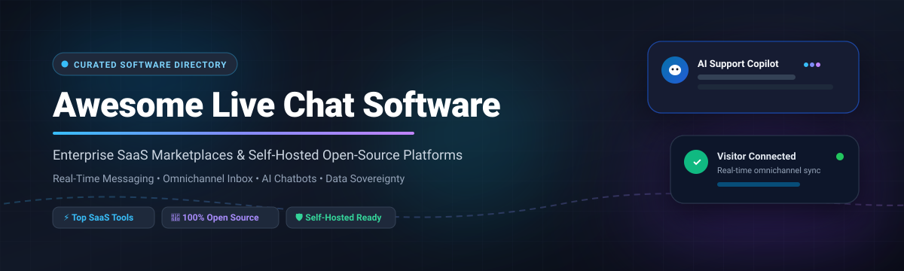

# 💬 Awesome Live Chat Software & Customer Messaging Platforms

  

  
  
  
  
  
  
  

---

## 🧭 Overview & Ecosystem Guide

Welcome to the definitive, SEO-optimized repository of **Live Chat Software**, **Customer Messaging Platforms**, **Shared Inboxes**, and **AI Copilot Helpdesks**. This directory tracks market-leading **commercial SaaS platforms** and self-hosted **open-source projects** engineered for real-time customer engagement, conversion rate optimization, omnichannel ticket routing, and conversational AI.

Whether you are an enterprise support architect seeking SOC2-compliant customer service suites or an engineer searching for an open-source, GDPR-compliant live chat widget with complete data sovereignty, this guide delivers accurate pricing models, free trial limitations, valuation metrics, and GitHub community stats.

---

## 📑 Table of Contents

- [📊 Sector Overview & Market Dynamics](#-sector-overview--market-dynamics)
- [🏢 SaaS & Hosted Live Chat Platforms](#-saas--hosted-live-chat-platforms)
- [🔓 Open-Source GitHub Projects](#-open-source-github-projects)
- [🧩 Frameworks & Building Blocks](#-frameworks--building-blocks)
- [⭐ Star History](#-star-history)
- [💖 Support](#-support)
- [🤝 How to Contribute](#-how-to-contribute)
- [📜 Disclaimer](#-disclaimer)

---

## 📊 Sector Overview & Market Dynamics

The global **Live Chat and Customer Engagement Software market is estimated at approximately $1.1 billion to $1.3 billion**, projected to exceed **$2.4 billion by 2030** at a compound annual growth rate (CAGR) of ~11.5%.

The sector is **moderately fragmented**: mega-cap CRM conglomerates (such as Salesforce and Zendesk) dominate high-touch enterprise omnichannel suites, while aggressive mid-market challengers (Intercom, Freshworks, Drift, LiveChat) and hundreds of self-hosted or niche live chat tools compete fiercely on AI deflection capabilities, rapid deployment, and privacy sovereignty.

---

## 🏢 SaaS & Hosted Live Chat Platforms

Below is the comparative breakdown of leading hosted live chat and conversational engagement platforms. Entries are sorted descending by **Company Scale (Valuation / Market Capitalization / Annual Revenue)**.

| 🏢 Platform | 💰 Pricing (Starting Tier) | 🎁 Free Tier Limit / Free Trial Policy | 📈 Company Scale (Valuation / Revenue) | 🎯 Core Focus & Key Capabilities |
| :--- | :--- | :--- | :--- | :--- |
| **[Salesforce Live Agent](https://www.salesforce.com/)** | $25/user/month (Starter Suite, billed annually) | 30-day free trial with full access to Starter Suite features (no credit card required) | Enterprise Giant (~$260B+ Market Cap; ~$38B+ ARR) | Native enterprise CRM integration, omni-channel routing, automated skill-based dispatch, and Service Cloud unified records. |
| **[Zendesk Chat](https://www.zendesk.com/)** | $55/agent/month (Support Team plan, billed annually) | 14-day free trial with full access to Zendesk Suite features and agent workspaces | Private Equity Scale (~$10.2B acquisition valuation by Hellman & Friedman; ~$1.7B+ ARR) | Robust ticket lifecycle management, omnichannel messaging triggers, CRM sync, macro shortcuts, and multi-brand reporting. |
| **[Intercom](https://www.intercom.com/)** | $29/seat/month (Essential plan, billed annually) | 14-day free trial with access to live messenger, Fin AI Copilot testing, and basic inbox features | Unicorn Tier (~$3.9B Valuation; ~$300M+ ARR) | Conversational relationship platform with Fin AI Copilot bot deflection, interactive product tours, and proactive sales outreach. |
| **[Freshchat](https://www.freshworks.com/freshchat/)** | $19/agent/month (Growth plan, billed annually) | Free for up to 10 agents with 100 incoming bot conversation sessions/month limit | Public Mid-Cap (~$4.5B Market Cap; ~$720M+ ARR) | Freddy AI chatbot support, unified omnichannel team inbox (WhatsApp, Instagram, web), predictive agent routing, and FAQ builder. |
| **[Drift](https://www.drift.com/)** | $2,500/month (Advanced plan, billed annually) | No permanent free plan; 14-day customized demo sandbox trial upon sales qualification | Enterprise MarTech (~$1.2B acquisition valuation by Salesloft / Vista Equity) | High-velocity B2B conversational marketing, target account deanonymization, calendar booking automation, and pipeline acceleration. |
| **[LiveChat](https://www.livechat.com/)** | $20/agent/month (Starter plan, billed annually) | 14-day free trial with access to Team tier capabilities (no credit card required) | Public Company (~$800M+ Market Cap on WSE: LVC; ~$85M+ ARR) | Specialized customer service suite with typing indicators, canned responses, e-commerce visitor cart tracking, and 200+ integrations. |
| **[Tidio](https://www.tidio.com/)** | $29/month (Starter plan; includes 3 seats and 100 handled conversations) | Free for up to 50 handled conversations/month with 100 Lyro AI triggers and basic live chat widget | High-Growth Scaleup (~$150M+ Valuation; ~$20M+ ARR) | Hybrid live chat combining rule-based chatbots, Lyro conversational AI, and Shopify/WordPress e-commerce integrations. |
| **[Crisp](https://crisp.chat/)** | $25/month/workspace (Pro tier, includes up to 4 operator seats) | Free plan limited to 2 operator seats, basic website chat widget, and 30-day chat history retention | Bootstrapped Scaleup (~$50M+ Estimated Valuation; ~$12M+ ARR) | Clean omnichannel customer messaging suite featuring shared inbox, video chat co-browsing, real-time translator, and knowledge base. |
| **[Olark](https://www.olark.com/)** | $29/seat/month (Standard tier, billed annually) | 14-day free trial with 20 chat conversations and full feature evaluation access | Bootstrapped Profitable (~$15M–$25M Estimated Valuation; ~$5M+ ARR) | Lightweight, accessible live chat widget featuring real-time visitor monitoring, automated greetings, transcription emails, and webhooks. |
| **[Pure Chat](https://www.purechat.com/)** | $39/month (Growth plan; covers 4 operators, billed annually) | 30-day free trial with unlimited live chats and full access to visitor analytics | Acquired Micro-Cap (~$10M Estimated Valuation; acquired by Ruby) | Straightforward live chat engine designed for small business operators, providing canned responses, schedule hours, and visitor tracking. |

---

## 🔓 Open-Source GitHub Projects

Explore the top open-source live chat software, self-hosted support inboxes, and real-time customer communication suites. Projects are ordered descending by **GitHub Stars** ⭐.

| 📦 Repository & Project | ⭐ GitHub Stars | 💻 Tech Stack | 📜 License | 💡 Highlights & Capabilities |
| :--- | :--- | :--- | :--- | :--- |
| **[Rocket.Chat](https://github.com/RocketChat/Rocket.Chat)** |  | TypeScript, Node.js, MongoDB, React | MIT | Enterprise-grade secure communication platform with built-in live chat website widgets, omnichannel agent routing (WhatsApp, SMS, Instagram), and video conferencing. |
| **[Chatwoot](https://github.com/chatwoot/chatwoot)** |  | Ruby on Rails, Vue.js, PostgreSQL, Redis | AGPL-3.0 | Modern alternative to Intercom and Zendesk. Features multi-brand unified inbox, live website messenger, CRM contact attributes, pre-chat forms, and AI copilot helpers. |
| **[Papercups](https://github.com/papercups-io/papercups)** |  | Elixir, Phoenix, React, TypeScript, PostgreSQL | MIT | Developer-first open-source live customer messaging widget with bidirectional Slack sync, custom React embed components, and webhook automation. |
| **[Zammad](https://github.com/zammad/zammad)** |  | Ruby on Rails, JavaScript, PostgreSQL/MySQL, Elasticsearch | AGPL-3.0 | Web-based open-source customer support and ticketing system with built-in live chat widget, multi-channel intake, SLA monitoring, and CTI phone integration. |
| **[FreeScout](https://github.com/freescout-help-desk/freescout)** |  | PHP, Laravel, MySQL, Vue.js | AGPL-3.0 | Lightweight self-hosted helpdesk and shared mailbox (Help Scout alternative) offering optional live web chat modules, WhatsApp integrations, and multi-mailbox workflows. |
| **[Chaskiq](https://github.com/chaskiq/chaskiq)** |  | Ruby on Rails, React, PostgreSQL, Redis | AGPL-3.0 | Full-featured conversational marketing suite with web messenger embed, agent conversation routing, WebRTC video calls, bot triggers, and onboarding email campaigns. |
| **[Peppermint](https://github.com/peppermint-lab/peppermint)** |  | Node.js, Express, React, Prisma | MIT | Lightweight self-hosted ticketing and customer help desk platform (alternative to Zendesk & Jira) designed for fast setup, intuitive agent inboxes, and minimal dependencies. |
| **[LibreDesk](https://github.com/abhinavxd/libredesk)** |  | Go, Vue.js 3, Shadcn UI, SQLite/PostgreSQL | AGPL-3.0 | Single-binary self-hosted customer support desk featuring shared inbox for live chat, email, and WhatsApp, real-time widget, knowledge base, and agent copilot. |
| **[Live Helper Chat](https://github.com/LiveHelperChat/livehelperchat)** |  | PHP, MySQL, JavaScript | Apache-2.0 | Battle-tested live support app handling over 10,000+ chats/day. Includes voice/video/screen sharing, Telegram & WhatsApp bots, ChatGPT/Ollama AI integrations, and mobile apps. |
| **[Mibew Messenger](https://github.com/Mibew/mibew)** |  | PHP, MySQL, JavaScript | Apache-2.0 | Classic open-source 1-on-1 live chat support application (Open Web Messenger) with operator queuing, customizable buttons, sound alerts, and zero monthly fees. |
| **[Tiledesk](https://github.com/Tiledesk/tiledesk)** |  | Node.js, Angular, MongoDB, Docker | MIT | Open-source conversational automation platform pairing visual LLM bot builders with live agent handoff, multichannel routing, and Kubernetes deployment templates. |
| **[Mesora](https://github.com/milmit/mesora-wordpress-live-chat)** |  | PHP, WordPress Plugin, JavaScript | GPL-2.0 | Self-hosted WordPress live chat plugin with WooCommerce contextual order cards, voice notes, local MySQL data storage, and external messenger mirroring. |

---

## 🧩 Frameworks & Building Blocks

When constructing custom in-house live chat stacks or conversational agent workflows:

- 🚀 **Self-Hosted Support Desks**: Deploy **Chatwoot**, **Rocket.Chat**, or **LibreDesk** for production customer-facing web chat, WhatsApp, and email aggregation.
- ⚡ **Real-Time Communication Protocols**: Utilize WebSockets (`ws`, `Socket.io`), Server-Sent Events (SSE), or MQTT brokers for millisecond message dispatch.
- 🤖 **LLM & AI Bot Integrations**: Connect open-source models via Ollama, vLLM, or LangChain to automate frontline support resolution before routing to human operators.
- 🔌 **WordPress Native Options**: Run **Mesora** or **Chatrix** for self-contained WordPress environments requiring zero third-party telemetry.

---

## 🤝 How to Contribute

Contributions from developers, maintainers, and support engineers are welcome!

1. 🍴 Fork this repository.
2. 📝 Add or refine entries in `README.md` maintaining table format, verified pricing, free tier limits, company scale, and star badges.
3. 🔗 Verify that all external URLs and GitHub stargazer badge links are functional.
4. 🚀 Submit a Pull Request with a descriptive summary of your additions.

---

## ⭐ Star History

---

## 💖 Support

Thank you so much for exploring and using this curated live chat software directory! 🙏

If you find this list useful or time-saving:
- ⭐ **Star this repository** to show your appreciation and help others discover it.
- 🍴 **Fork it** to maintain your own custom list or contribute back.
- 📢 **Share it** with colleagues, dev communities, and customer support leads.
- ☕ **Buy me a coffee / Sponsor**: If you'd like to support ongoing maintenance and curation of open developer resources, feel free to sponsor via the [GitHub Sponsors Dashboard](https://github.com/sponsors/ishandutta2007).

Every bit of encouragement is deeply appreciated! ✨

---

## 📜 Disclaimer

- This repository is a community-curated directory intended for research, architectural planning, and educational purposes.
- All product names, logos, and brands are property of their respective owners.
- Live chat installations must adhere to regional privacy regulations (including GDPR, CCPA, and ePrivacy Directive) regarding tracking cookies, transcript retention, and visitor consent.

---

  <b>Built with ❤️ for support teams, engineering leads, and open-source advocates.</b> 
  Star ⭐ this repo if you find it helpful!

